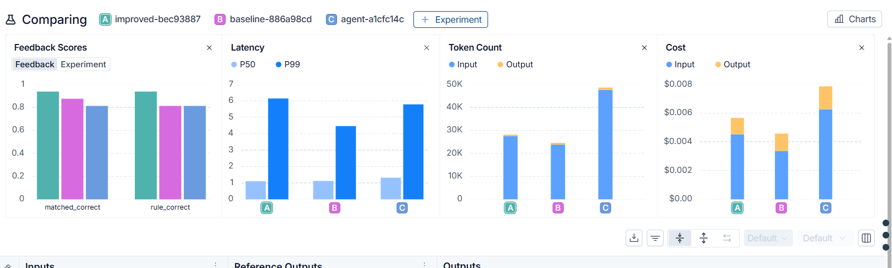
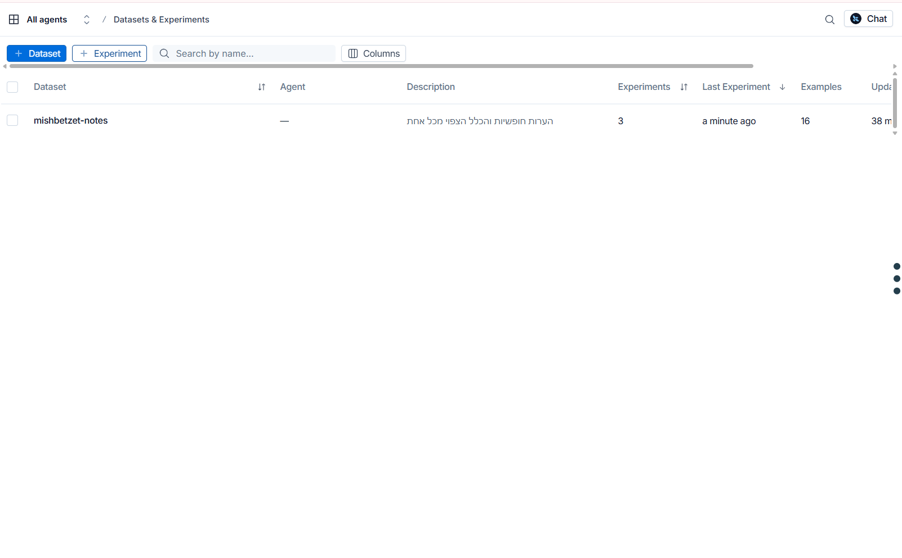
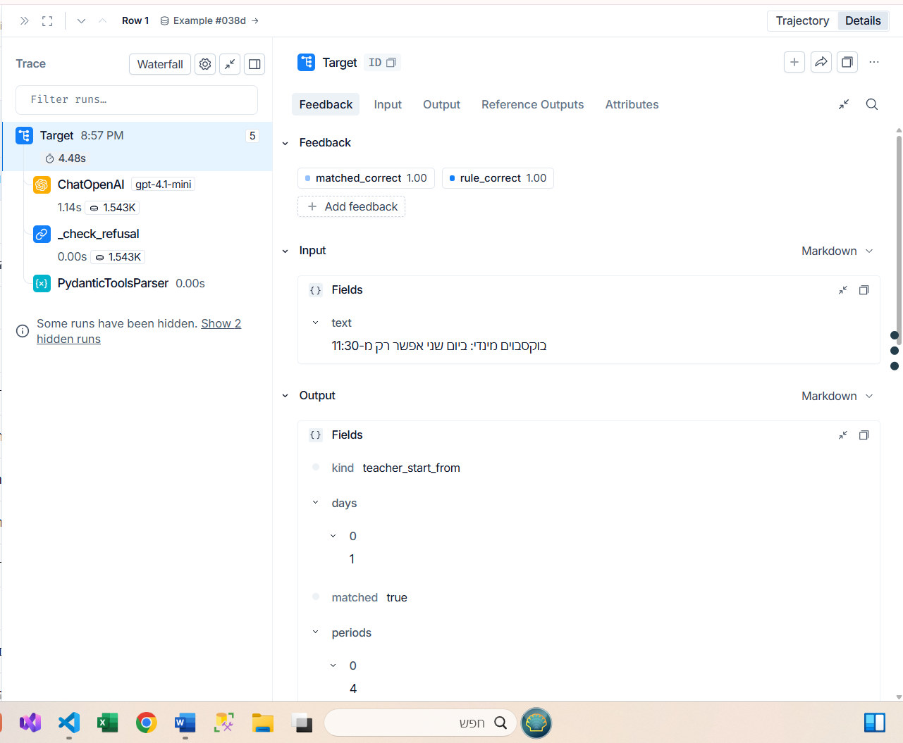
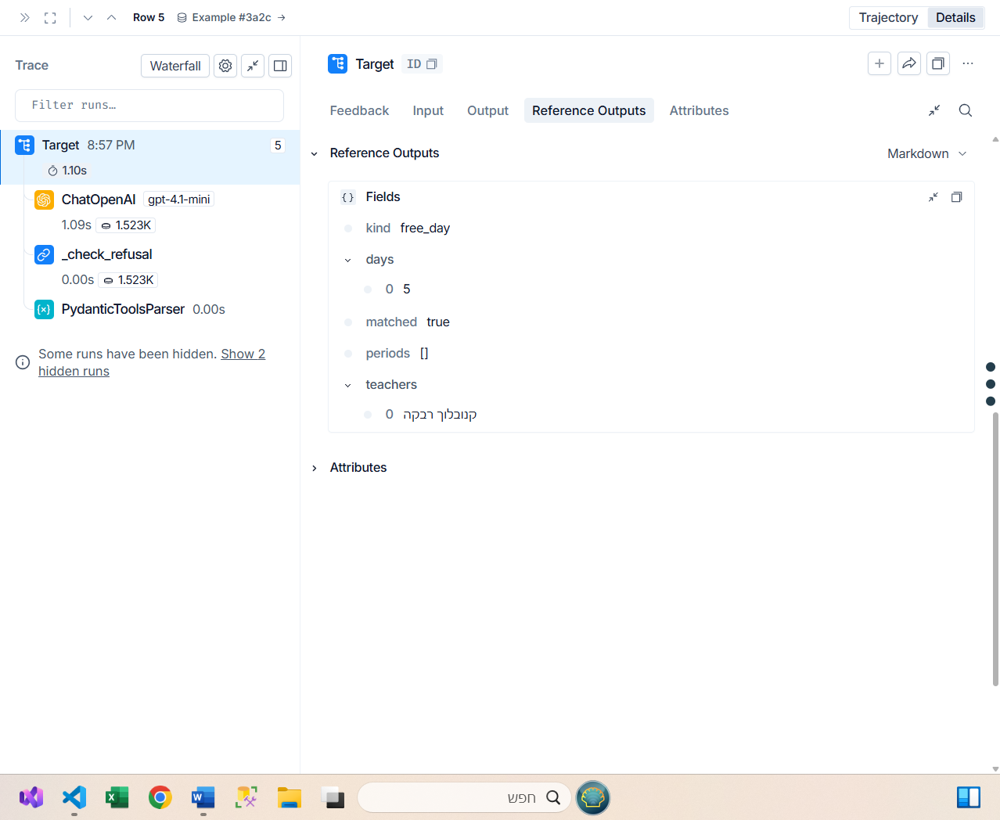

# משבצת: אתר הדגמה

גרסת הדגמה שעובדת מקצה לקצה, עם נתונים קבועים בקוד:
- **אין מסד נתונים:** הנתונים נמצאים בקובץ אחד.
```
backend/app/data.py
```
- **אין פריסה לענן:** האתר רץ על המחשב שלך.
- **אין חובה במפתח למודל שפה.** בלי מפתח האתר עובד ב"מצב הדגמה", עם מפענח פשוט ומוגבל. עם מפתח הוא משתמש במודל אמיתי.

הנתונים בהדגמה מבוססים על בית ספר בית יעקב אמיתי, לפי מערכת תשפ"ז: 49 כיתות (א' עד ח'), 89 מורות, הקבצות בחשבון ובאנגלית, חצאי כיתה ושיעורי סיוע. המבנה, המקצועות והשעות אמיתיים, וכל שמות המורות בדויים. יש בהדגמה 88 טפסים של מורות (ימים חופשיים, בקשות שעות והערות חופשיות), 17 כללי בית ספר ו־17 הערות של המנהלת. בגודל הזה בניית מערכת לוקחת עד כמה דקות.

---

## בית ספר אחר: ייבוא מאקסל

בלשונית "בית הספר" מורידים תבנית אקסל (כיתות, מורות, מקצועות, שעות, ימי לימוד ומספר השיעורים בכל יום),
ממלאים אותה ומעלים. המערכת בודקת את הקובץ, מציגה שגיאות עם מספרי שורות, וטוענת את בית הספר החדש.
כללי בית הספר שלא רלוונטיים (מקצוע שאין, יום שאין) מוסרים לבד. כפתור "חזרה לנתוני ההדגמה" מחזיר את בית הספר המקורי.
הנתונים המיובאים נשמרים בקובץ `backend/app/custom_school.json` (לא נכנס ל-git).

## כיול הכללים מול המערכת האמיתית

השוואה לטבלה האמיתית (מורות בבית הספר שממנו נלקחו הנתונים): חלונות, ימים עם שיעור בודד, התחלה מאוחרת,
כמה ימים קודש בשעה הראשונה ועוד. הכללים כוילו כך שהם קרובים למה שקורה בפועל (למשל קודש בשעה הראשונה ב-3 ימים לפחות,
ואנגלית יכולה להיות פעמיים ביום). הכללים שדורשים שלמות (5 שיעורים ביום, שישי מלא) הם חובה, והשאר קנסות.

## הרצה

צריך שני דברים מותקנים:
```
Python 3.11+
Node.js 20+   (רק אם רוצים לבנות את הממשק מחדש)
```

**1. השרת** (הממשק הבנוי כבר כלול, ולכן מספיק להריץ את השרת):
```bash
cd backend
pip install -r requirements.txt
uvicorn app.api:app --port 8000
```
פותחים בדפדפן:
```
http://localhost:8000
```

**2. עם מודל שפה אמיתי (לא חובה):**
```bash
export OPENAI_API_KEY=sk-...
export OPENAI_MODEL=gpt-4.1-mini      # או כל מודל אחר שזמין לך
uvicorn app.api:app --port 8000
```
ב־Windows, במקום `export` כותבים:
```
set OPENAI_API_KEY=sk-...
```

**3. פיתוח הממשק (לא חובה):**
```bash
cd frontend
npm install
npm run dev        # פותח את הממשק על פורט 5173, מול השרת שרץ על 8000
npm run build      # בונה מחדש את התיקייה שהשרת מגיש
```

---

## מה לנסות

1. **לוח בקרה:** השלבים על הסרגל, והטפסים של המורות.
2. **שיבוץ:** טבלת השיבוץ לכל שכבה. בשכבה ד' יש מאגר למולדת, ובכל הכיתות יש מלאכה ומחשבים במקביל.
3. **בניית המערכת:** לוחצים "התחלת בנייה".
   - **עצירה 1:** המערכת מציגה איך הבינה את ההערות. מאשרים.
   - הפותר בונה מערכת, ומוצגות החריגות כפתקים צהובים.
   - לוחצים על אפשרות, למשל "לתת את היום החלופי". המערכת בונה מחדש (לולאה).
   - כותבים בצ'אט: `קליין ביום שלישי חופשי`. המערכת מראה מה ישתנה ומבקשת אישור.
   - כותבים משהו לא ברור, למשל `תסדרי את זה`. המערכת שואלת שאלת הבהרה.
   - שואלים: `למה לשטרן אין חלון?`
   - לוחצים "אישור ופרסום למורות".
4. **מצב מורה** (המתג בפינה): ממלאים בקשה חופשית, למשל `ביום חמישי לא לפני 9`, ומאשרים את התרגום. אחרי הפרסום רואים כאן את המערכת האישית.

---

## דרישות התרגיל: איפה כל דרישה

| דרישה | איפה |
|---|---|
| גרף LangGraph | `backend/app/graph.py` (צמתים, קשתות ומצב) |
| לולאה | אחרי כל שינוי חוזרים לפותר (`apply_action`, `apply_decision` ו-`rebuild` אל `solve`), ולולאת הסוכן `agent → tools → agent` |
| ענף מותנה | `route_after_solve`, `route_message`, `route_after_agent`, `route_after_tools`, `route_action`, `route_after_simulate`, `route_after_confirm` |
| עצירה לאישור אדם | `review_translations` (אישור התרגום), `await_principal` (המתנה להודעה או להחלטה), `confirm` (אישור שינוי אחרי הדמיה) |
| מאגר דוגמאות והערכה ב-LangSmith | `backend/evals/` (`examples.py`, `create_dataset.py`, `evaluators.py`, `run_experiment.py`) |
| ניסוי לפני ואחרי | `baseline` מול `improved`: מ-13 ל-15 מתוך 16 |
| עקבות ותובנה | הסעיפים [הערכה ב-LangSmith](#הערכה-ב-langsmith-לפני-ואחרי) ו[עקבות ומאגר](#עקבות-tracing-ומאגר) |

---

## מבנה הקוד

```
backend/app/
  data.py      נתוני בית הספר (קבועים)
  solver.py    פותר האילוצים: בונה מערכת ומחזיר אילו כללים לא קוימו
  llm.py       שרשראות (Prompt | Model | Parser) + מפענח פשוט למצב הדגמה
  agent.py     ★ הסוכן של הצ'אט: ההנחיה והקריאה למודל עם כלים
  tools.py     ★ הכלים של הסוכן: 8 כלי קריאה ו-3 כלי שינוי (שעוברים אישור)
  graph.py     ★ הגרף: מצב, צמתים, קשתות, ענפים, לולאות ועצירות
  api.py       השרת: מתחיל ריצה, ממשיך אחרי עצירה, ומחזיר מצב
frontend/src/
  pages/Workspace.tsx   סביבת העבודה: צ'אט + מערכת
  ...                   שאר המסכים
```

### הזרימה בגרף
```
START → load_data → translate_notes → review_translations ⏸ → solve
solve → [בלתי אפשרי] diagnose → await_principal
      → [יש חריגות]  explain  → await_principal
      → [אין חריגות]           → await_principal ⏸
await_principal → [כפתור]  apply_decision → solve          (לולאה)
                → [טקסט]   agent → [קריאות כלים] tools → [הוצעה פעולה] simulate → confirm ⏸ → apply_action → solve (לולאה)
                                                       → [אחרת]       agent                       (לולאת הסוכן)
                                 → [תשובה בטקסט] agent_reply → await_principal
                                 → [כשל במודל]   interpret (המסווג הישן)
                → [אישור]  finalize → await_principal
```
⏸ = עצירה לאישור אדם.

### הצ'אט: סוכן עם כלים
המודל לא ממלא טופס סיווג. הוא מקבל כלים, מחליט מה להפעיל ורואה את התוצאה, וחוזר על זה עד שיש לו תשובה
(`agent → tools → agent`). כלי קריאה (חריגות, מערכת של מורה, סטטיסטיקות, חיפוש שיעורים, שעות פנויות) רצים מיד,
והחישובים נעשים בקוד. כלי שינוי (`propose_rule`, `propose_move`, `rebuild`) לא משנים כלום: הם מכינים פעולה שעוברת
הדמיה ועצירה לאישור, ורק אז הפותר בונה. ללא `OPENAI_API_KEY` (או עם `CHAT_MODE=router`) הצ'אט עובד כמסווג הישן.

השוואה ב-LangSmith: `python -m evals.run_experiment --name baseline` (המסווג הישן) מול
`python -m evals.run_experiment --name agent --target agent` (הסוכן).

---

## הערכה ב-LangSmith: לפני ואחרי

**מה בדקנו.** מאגר של 16 הערות חופשיות של מנהלת (`mishbetzet-notes`), ולכל הערה התשובה הנכונה: סוג הכלל, המורה,
היום והשעה. שני מעריכים אוטומטיים נותנים ציון 1 או 0 לכל דוגמה: `matched_correct` (האם יש כלל מתאים או אין) ו-`rule_correct`
(האם הכלל כולו נכון). הקוד ב-`backend/evals/`.

**ניסוי "לפני" (`baseline`): 13 מתוך 16.** שלוש טעויות, ולכל אחת סיבה אחרת:

| ההערה | מה קרה |
|---|---|
| "ביום ראשון אני לא יכולה" (בלי שם מורה) | המודל המציא מורה, הראשונה ברשימה, כי ההנחיה חייבה למלא שם |
| "טורק שרה - לסיים עד 12:15" | טעות של אחד: החזיר את השיעור שמתחיל ב-12:15 במקום זה שמסתיים בו |
| "אשמח ללמד שני שיעורים רצופים באותה כיתה" | ניחש כלל קרוב אבל שגוי, במקום להגיד שאין כלל |

**השיפור.** שלושה כללי זהירות בהנחיה: אסור לנחש שם מורה שלא נכתב, כלל מפורש לגבי גבול השעה (עם דוגמה), וכלל "קרוב"
פירושו כלל שמבצע בדיוק את מה שהתבקש.

**ניסוי "אחרי" (`improved`): 15 מתוך 16.** שתיים משלוש הטעויות תוקנו (הטעות של אחד בשעה, והכלל הקרוב והשגוי), ואף דוגמה
שהייתה נכונה לא נשברה. הטעות השלישית נשארה: על "ביום ראשון אני לא יכולה" המודל שוב המציא מורה (הפעם "בלוך מלכה"),
למרות ההוראה המפורשת בהנחיה. המחיר של השיפור: ההנחיה ארוכה יותר, ולכן כ-12% יותר טוקנים של קלט וכ-25% יותר עלות לקריאה.



**התובנה.** כשההנחיה מחייבת למלא שדה והמידע חסר, מודל קטן ממציא, וגם הוראה מפורשת בהנחיה לא תמיד עוצרת אותו
(הוא המציא מורה גם אחרי התיקון). רק ההערכה האוטומטית הראתה את זה בפועל, ורק היא אפשרה לבדוק שהתיקון עובד בלי לשבור
דברים אחרים. לכן הבקרה על דברים שאסור להמציא צריכה לשבת בקוד ולא בהנחיה: זה בדיוק הרעיון "מודל בקצוות, קוד בליבה".

**מהניסוי לארכיטקטורה.** גם התיקון הזה נשאר שביר: הצ'אט עדיין היה מסווג שדוחס כל הודעה לרשימה קבועה של פעולות. לכן
הוחלף בסוכן עם כלים (`backend/app/agent.py`, `tools.py`): המודל מחליט איזה כלי להפעיל, והפותר נשאר היחיד שמשנה
את המערכת, אחרי עצירה לאישור. ההשוואה: `python -m evals.run_experiment --name agent --target agent`.

**ניסוי הסוכן (`agent`): 13 מתוך 16.** במבחן הזה, שבודק תרגום של הערה בודדת לכלל, הסוכן **לא עדיף** על השרשרת המשופרת
(15 מתוך 16). הוא לא החזיר כלל להערה על הסגניות ולהערה על הלר מרים, ועדיין ניחש כלל קרוב לזילברמן. הערך של הסוכן הוא
ביכולות שהמבחן הזה לא מודד: מענה על שאלות מהנתונים, חיפוש, ושרשראות של כמה כלים. למדתי שצריך מאגר בדיקה נפרד לסוכן
(שאלות ושרשראות כלים), ולא רק לתרגום.

### עקבות (Tracing) ומאגר

העקבות נשלחות ל-LangSmith רק מהגדרות ב-`.env` (`LANGSMITH_TRACING`, `LANGSMITH_API_KEY`, `LANGSMITH_PROJECT`), בלי קוד נוסף.

**המאגר** `mishbetzet-notes` עם 16 הדוגמאות והניסויים שרצו עליו:



**עקבה של דוגמה אחת בניסוי:** הקלט, הפלט והציונים, ומתחת לזה הצינור: קריאה למודל (`gpt-4.1-mini`) ופענוח התשובה.



**התשובה הנכונה לאותה דוגמה** (Reference Outputs), שמולה מושווה מה שהמודל החזיר:



---

## החלטות מרכזיות

1. **הפותר מחליט על השיבוץ, והמודל נמצא בקצוות.** המודל מבין את מה שהמנהלת כותבת ומנסח תשובות, והפותר בונה את המערכת.
   כך אי אפשר לקבל שיעור שלא קיים או התנגשות בין כיתות.
   החלופה שנדחתה: מודל שבונה את מערכת השעות בעצמו.
2. **כלי השינוי רק מכינים פעולה.** כל שינוי עובר הדמיה שמראה מה יזוז ואילו כללים ייפגעו, ואז אישור של המנהלת, ורק אחר כך בנייה.
   החלופה שנדחתה: שינוי מיד כשהמודל מבקש.
3. **דברים שהמודל אסור שימציא נבדקים בקוד.** שם מורה ופרמטרים של כלל נבדקים מול הנתונים, ומורה שלא הוזכרה בהערה נפסלת.
   הסיבה: גם אחרי שיפור ההנחיה המודל המשיך להמציא מורה באחת הדוגמאות.
   החלופה שנדחתה: להסתמך רק על ההנחיה.
4. **הצ'אט הוא סוכן עם כלים ולא מסווג.** הוא יכול לענות על שאלות כמו "אצל איזה מורות יש חריגות", שמסווג של הבנת הודעה אחת לא יכול לענות עליהן.
   המסווג הישן נשאר כגיבוי למצב בלי מפתח.
   החלופה שנדחתה: מסווג בלבד.
5. **הכללים רכים, עם משקל.** כך תמיד אפשר לבנות מערכת, והחריגות מדווחות למנהלת במקום שהבנייה תיכשל.
   החלופה שנדחתה: כל הכללים כחובה, שעלולים להפוך את הבעיה לבלתי פתירה.
6. **מצב הדגמה בלי מפתח.** מפענח פשוט לפי דפוסים מאפשר להריץ ולהציג את האתר בלי חיבור למודל.

---

## מגבלות

- **מעט נתונים.** מאגר ההערכה כולל 16 דוגמאות והוא מודד רק תרגום הערות לכללים. הוא לא מודד שיחה או בחירת כלים בצ'אט.
- **הסוכן לא ניצח בבדיקה הזאת.** הוא קיבל 13 מתוך 16, כמו הגרסה הפשוטה הראשונה. הבדיקה לא מודדת את מה שהסוכן נבנה בשבילו, ולכן עדיפות הסוכן לא הוכחה כאן.
- **כללים רכים.** כלל כמו "לאורה קאופמן אסור חלון ביום שישי" נכנס עם משקל ולא כחובה מוחלטת, ולכן אין הבטחה שיקוים. הצ'אט עשוי להודיע "בוצע" גם כשהכלל לא קוים לגמרי.
- **המודל ממציא לפעמים.** באחת הדוגמאות המודל המשיך להמציא מורה גם אחרי שיפור ההנחיה. הוספנו בדיקה בקוד, אבל לא הרצנו אותה מחדש כניסוי ב-LangSmith.
- **הרצה אחת לכל ניסוי.** התוצאות של מודל שפה משתנות בין הרצות, ולכן ההפרשים הקטנים (13 מול 15) הם אינדיקציה ולא הוכחה.

---

## מה עוד חסר (לעומת האפיון)

- מסד נתונים, התחברות והרשאות אמיתיות. כרגע יש רק מתג "מנהלת / מורה".
- שמירה קבועה של עריכות. אפשר לערוך מהאתר את טבלת השיבוץ (החלפת מורה) ולבטל או לערוך כללים, אבל השינויים נשמרים רק בזיכרון השרת. עריכה של הטפסים מתבצעת במצב מורה.
- העלאת צילום של טבלה.
- מנהל אתר.
- הזזת שיעור מסוים בצ'אט. הגרף כבר תומך בזה, אבל המפענח הפשוט לא מזהה בקשה כזאת. עם מודל שפה אמיתי זה יעבוד.
- ייצוא לאקסל ולהדפסה.
- שמירת מצב הגרף במסד נתונים. כרגע הוא נשמר בזיכרון, ונמחק כשהשרת מופעל מחדש.
